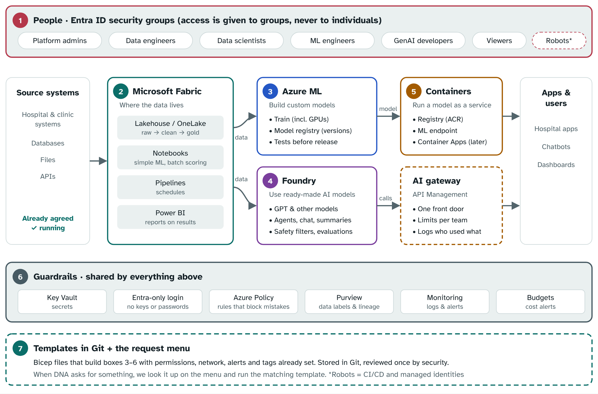

# DNA ML Platform

The machine learning platform for the DNA team: Microsoft Fabric for data, Azure Machine Learning for building models, and Microsoft Foundry for ready-made AI models. Everything is defined here as code with **Terraform**, so it's built the same way every time and every change is reviewed.

**Current scope: the sandbox.** Public endpoints, Entra-only login, an Azure ML managed network, and synthetic or masked data only. See the [network decision](docs/network-decision.md).



## The repo in three parts

| Folder | What it is | When you touch it |
|---|---|---|
| [`bootstrap/`](bootstrap/) | **Once-off setup:** state storage, group IDs, guardrail policies, the identity-team request, and the step-by-step setup guide | Once, when setting up |
| [`platform/`](platform/) | **The shared foundation:** logs, Key Vault, alert email, access-change alerts, CI/CD identity, delete lock, budget | Rarely. Platform team only. |
| [`requests/`](requests/) | **Day-to-day:** one YAML file per team. Each team gets an Azure ML workspace, a Foundry resource with projects and approved models, budgets, and Azure and Fabric roles | Every menu request |
| [`docs/`](docs/) | The beginner guide, request menu, permissions, network decision, promotion checklist | Reading and reference |

```text
dna-ml-platform/
├── bootstrap/
│   ├── README.md                    ← START HERE: once-off setup, step by step
│   ├── bootstrap-state.sh           ← secure storage for the Terraform state
│   ├── get-group-ids.sh             ← prints the Entra group IDs to paste
│   ├── assign-policies.sh           ← guardrail policies (+ policies.md)
│   └── identity-team-request.md     ← email to request the Entra groups
├── platform/                        ← Terraform: shared foundation (+ sandbox.tfvars)
├── requests/
│   ├── README.md                    ← how to handle a request
│   ├── teams/dna.yaml               ← everything the DNA team has
│   ├── azure/                       ← Terraform: team files → Azure resources
│   ├── fabric/                      ← Terraform: team files → Fabric workspace roles
│   └── modules/team-azure/          ← what one team gets
├── scripts/
│   ├── deploy.sh                    ← plan + apply: platform | requests | fabric
│   ├── sandbox-cleanup-report.sh    ← monthly expiry check
│   └── config.sh                    ← group names and region
├── docs/
│   ├── DNA-ML-Platform-Guide.docx   ← full beginner guide (Word; guide.md is the same in Markdown)
│   ├── request-menu.md              ← "if DNA asks for X, change Y"
│   ├── permissions.md               ← who gets which role
│   ├── network-decision.md          ← sandbox network choices and when to go private
│   └── promotion-checklist.md       ← sandbox → production, plus the test run
└── .github/
    ├── ISSUE_TEMPLATE/              ← request forms for the DNA team
    └── workflows/                   ← Validate (every push) and Deploy (plan/apply, approval required)
```

## Getting started

Follow [bootstrap/README.md](bootstrap/README.md). In short:

```bash
az login
az account set --subscription "<sandbox subscription>"
bootstrap/bootstrap-state.sh
bootstrap/get-group-ids.sh          # paste the IDs into the settings files
scripts/deploy.sh platform --plan
scripts/deploy.sh platform
scripts/deploy.sh requests
scripts/deploy.sh fabric
bootstrap/assign-policies.sh
```

You need the Azure CLI, **Terraform 1.9+** and Bash.

## Handling requests

1. The DNA team opens an issue with one of the request forms (**Issues → New issue**).
2. You change their team file, `requests/teams/dna.yaml`. [docs/request-menu.md](docs/request-menu.md) says which line.
3. Pull request, **Validate** passes, merge.
4. **Actions → Deploy**, part `requests`: plan first, then apply. The `sandbox` environment asks for your approval.

Never change platform resources in the Azure portal: Terraform will undo it. Change the code.

## Status

All three Terraform stacks pass `terraform validate` in GitHub Actions, but **nothing has been applied to Azure yet**. Run the plans first and expect to fix small things on the first real deployment. `bootstrap/assign-policies.sh` skips and reports any policy name it can't find.
