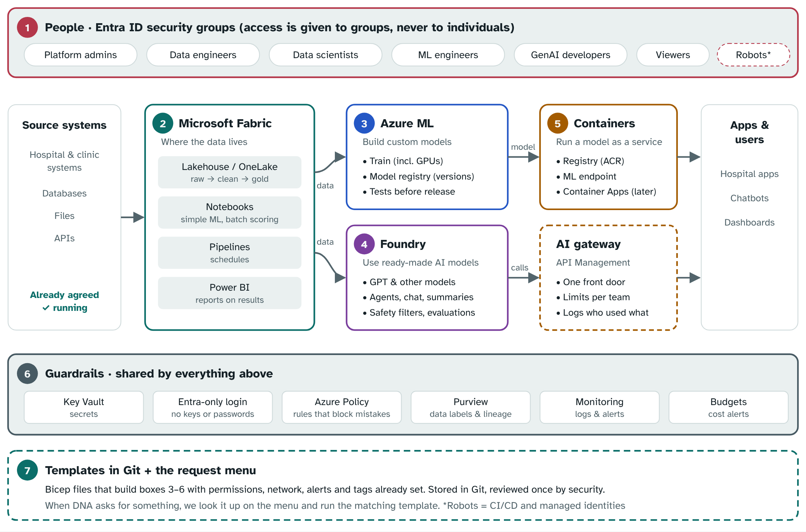

# DNA ML Platform Guide

A start-to-finish guide for building the machine learning platform before anyone asks for it. First the picture of what we're building, then twelve steps in order: groups, permissions, guardrails, templates, alerts and the request menu. No prior experience assumed. This edition covers the **sandbox**: public endpoints, Entra-only login, an Azure ML managed network, and synthetic or masked data only.

Interactive version (with copy buttons and checklist): <https://claude.ai/artifact/SMemCnJxFQH27q5zsoMi5q>

## What we're building

The DNA team already has data landing in Fabric. On top of that we're adding three things: a place to **build** models (Azure ML), a place to **use** ready-made AI models like GPT (Foundry), and a way to **run** models as a service (containers). Around all of it sit the people, the guardrails and the templates.

Read the diagram top to bottom: **people** get access through groups, **data** flows left to right through the services, the **guardrails** protect everything, and **templates** build it all.

### What each part is, in plain words

### 1 · People: Entra ID groups

Instead of giving Sipho or Thandi access one by one, we make a group like "DNA Data Scientists" and give the *group* the access. New person joins? Add them to the group. Person leaves? Remove them. Done.

"Robots" are the automated accounts that run jobs and pipelines. They get their own identities so nothing depends on a real person's login.

### 2 · Data: Microsoft Fabric

Already built. Data arrives from the source systems, gets cleaned up in stages, and sits in OneLake. Fabric can also do simple machine learning itself and score data in bulk on a schedule.

Example: every night, score yesterday's forms and show the suspicious ones in Power BI.

### 3 · Build: Azure Machine Learning

The workshop for *custom* models: ones the team trains themselves on their own data, especially bigger ones that need powerful GPU computers. It keeps every version of every model and tests it before release.

Example: the anomaly detector in our own repo is trained here.

### 4 · Use: Microsoft Foundry

The shop for *ready-made* AI models such as GPT. Nobody trains these; you switch one on and use it for chat, summaries, reading documents or agents. Foundry adds safety filters and ways to test quality.

Example: summarise a patient's intake notes for the nurse.

### 5 · Run: Containers and the AI gateway

A container is a sealed box with the model and everything it needs inside, so it runs the same anywhere. Azure ML makes these boxes for us automatically. The AI gateway is one front door in front of the Foundry models so we can limit and log usage per team.

Only needed when an app must call a model live. Nightly batch jobs don't need it.

### 6 · Guardrails: The safety layer

Passwords live in Key Vault, everyone signs in with Entra (no shared keys or API keys), Azure ML compute runs in a Microsoft-managed network, Azure Policy blocks mistakes before they happen, Purview labels sensitive data, monitoring raises alerts, and budgets warn us before the bill surprises anyone.

This is what "governance" means in practice.

### 7 · Templates: Templates and the request menu

A template is a recipe file that builds boxes 3 to 6 with all the right settings in one command. The request menu is a simple list: "if DNA asks for X, run template Y." That is how we're ready before anyone asks.

Ready-made in the `dna-ml-platform` repo, written in Terraform.

## The step-by-step guide

Do these in order. Each step says **why**, **what to do** and **how you know it worked**. Tick the box at the end of each step; your ticks are saved in this browser so you can come back later.

Anything in `<angle brackets>` is a placeholder: swap in your real value. Names like `sbx` mean "sandbox". When you build dev, test or prod later, repeat the same steps with `dev`, `tst` or `prd`.

### Step 0 · Before you start

Make sure you have the access and tools below. Without them you'll get stuck halfway through a step.

| You need                                                                         | Why                                                                                     | Who gives it               |
|----------------------------------------------------------------------------------|-----------------------------------------------------------------------------------------|----------------------------|
| The six Entra groups, with you as an owner                                       | Step 1 (we request them, we don't create them)                                          | Identity team              |
| **Owner** (or Contributor + User Access Administrator) on the Azure subscription | To create resources and give permissions                                                | Cloud / subscription owner |
| Fabric admin, or a friend who is one                                             | Step 6 tenant settings                                                                  | Fabric / Power BI admin    |
| Azure CLI (`az`), VS Code, Git                                                   | To run the commands and templates                                                       | Install yourself           |
| A contact in the network team                                                    | Not needed for the sandbox (public endpoints). Needed later for dev, prod or real data. | Network team               |
| A contact in security / compliance                                               | Sign-off on Steps 2, 5 and 12                                                           | Security team              |

Log in and pick the right subscription:

    az login
    az account set --subscription "<your-subscription-name-or-id>"
    az account show --query name -o tsv   # check: is this the right one?

**☐ I have the access and tools**

### Step 1 · Request the Entra security groups

**Why:** permissions always go to groups, never to people. Then onboarding is "add to group" and offboarding is "remove from group". Auditors love this.

**Who does what:** the **identity team** owns Entra, so they create the groups. That's normal and doesn't slow anything down, as long as we're made **group owners**. Everything after creation stays with us.

| Task                                             | Who                                                       |
|--------------------------------------------------|-----------------------------------------------------------|
| Create the groups                                | Identity team (we send the request below)                 |
| Decide who goes in each group                    | Us + the DNA lead                                         |
| Add and remove members day to day                | Us, as group owners. No ticket needed.                    |
| Give groups permissions in Azure (Step 2)        | Us. Needs Owner on the Azure resources, not Entra rights. |
| Give groups access to Fabric workspaces (Step 6) | Us, as workspace admin                                    |

One group per type of person. These are the same in every organisation, so request them now even though nobody is using ML yet:

| Group name                | Who goes in it                                          |
|---------------------------|---------------------------------------------------------|
| `sg-dna-platform-admins`  | You and the platform team. Builds and fixes everything. |
| `sg-dna-data-engineers`   | People who bring data in and clean it in Fabric.        |
| `sg-dna-data-scientists`  | People who explore data and train models.               |
| `sg-dna-ml-engineers`     | People who put models into production.                  |
| `sg-dna-genai-developers` | People building chatbots and apps on GPT-type models.   |
| `sg-dna-viewers`          | Business users who only look at results.                |

**The request to send the identity team** (copy, fill in the names, send):

    Hi team,

    We're setting up the ML platform for the DNA team and need the following
    Entra SECURITY groups (not Microsoft 365 groups), with assigned membership:

      sg-dna-platform-admins
      sg-dna-data-engineers
      sg-dna-data-scientists
      sg-dna-ml-engineers
      sg-dna-genai-developers
      sg-dna-viewers

    Please set <your name> and <DNA lead name> as OWNERS of these groups so
    we can manage membership without raising tickets.

    If these names don't fit your naming convention, please adjust them and
    send us the final names and their object IDs.

    These groups are only for Azure role assignments and Fabric workspace
    access. They don't need any Entra admin roles.

    Thanks!

**Ask them two questions while you're at it:**

- **What's your naming convention?** If they rename the groups, use their names everywhere in this guide and in the permissions table.
- **Do you use PIM** (Privileged Identity Management) for admin groups? If yes, you may have to "activate" your membership of `sg-dna-platform-admins` when you need it. That's good practice; just plan for it.

**If they won't make you owners:** every new joiner then waits for an identity-team ticket. Agree a turnaround (for example, same day) and write it on the request menu in Step 11 so the DNA team knows what to expect.

**The robots.** Automated jobs need identities too, and you can make these yourself without the identity team:

- **CI/CD identity:** instead of a service principal (which would need another identity-team request), create a **user-assigned managed identity** in Azure. It supports the same password-free OIDC login from GitHub or Azure DevOps.
- **Managed identities** for the ML workspace, endpoints and apps are created by Azure automatically. You just give them permissions.

<!-- -->

    az identity create -g rg-dna-shared-sbx-san-01 -n id-dna-cicd-sbx-san-01

    # let GitHub Actions on the main branch log in as it (no password)
    az identity federated-credential create -g rg-dna-shared-sbx-san-01 \
      --identity-name id-dna-cicd-sbx-san-01 --name github-main \
      --issuer https://token.actions.githubusercontent.com \
      --subject repo:<org>/<repo>:ref:refs/heads/main \
      --audiences api://AzureADTokenExchange

Run this after Step 3, once `rg-dna-shared-sbx-san-01` exists.

**How you know it worked:** the identity team confirms the six groups, you can see yourself listed as an *owner* on each one in the Entra portal, and you can add a test person to `sg-dna-viewers` yourself.

**☐ Groups requested and received, we're owners**

### Step 2 · Agree the permissions table

**Why:** this table is the heart of governance. Agree it once with security, and every template after this just copies it.

Each cell is a **built-in Azure role** (or Fabric workspace role). "–" means no access. Role names change occasionally, so check them in the portal under *Access control (IAM) → Add role assignment* before you finalise.

| Group                     | Fabric workspace                       | Azure ML workspace                                | Azure ML storage account                                                 | Foundry                                         | Container registry | Key Vault               |
|---------------------------|----------------------------------------|---------------------------------------------------|--------------------------------------------------------------------------|-------------------------------------------------|--------------------|-------------------------|
| Platform admins           | Admin                                  | Owner                                             | Storage Blob Data Contributor                                            | Azure AI Account Owner                          | Owner              | Key Vault Administrator |
| Data engineers            | Member                                 | Reader                                            | –                                                                        | –                                               | –                  | –                       |
| Data scientists           | Contributor                            | AzureML Data Scientist + AzureML Compute Operator | Storage Blob Data Contributor + Storage File Data Privileged Contributor | Azure AI User                                   | –                  | –                       |
| ML engineers              | Contributor                            | AzureML Data Scientist + AzureML Compute Operator | Storage Blob Data Contributor + Storage File Data Privileged Contributor | Azure AI User                                   | AcrPull            | Key Vault Secrets User  |
| GenAI developers          | Viewer                                 | –                                                 | –                                                                        | Azure AI User (leads: Azure AI Project Manager) | –                  | –                       |
| Viewers                   | Viewer                                 | Reader                                            | –                                                                        | Reader                                          | –                  | –                       |
| CI/CD robot               | Contributor                            | Contributor (that workspace only)                 | Storage Blob Data Contributor                                            | Azure AI User                                   | AcrPush            | Key Vault Secrets User  |
| Running model / app robot | Contributor (only if it reads OneLake) | –                                                 | –                                                                        | Cognitive Services OpenAI User                  | AcrPull            | Key Vault Secrets User  |

**Also for everyone except the robots:** *Reader* on `rg-dna-ml-sbx-san-01` and `rg-dna-ai-sbx-san-01` for the groups that use them, so people can see the resources in the Azure portal without being able to change them.

**Why the storage roles matter:** the sandbox switches shared keys off (Entra-only login). Azure ML studio then opens files and notebooks with *the person's own login*. Without the two storage roles, data scientists get "access denied" on their data and notebooks.

### Data scientist access in full

The most common request. Everything is given to `sg-dna-data-scientists`:

| Where            | Role                                     | Assigned on                                                          | Lets them                                                                                                                     |
|------------------|------------------------------------------|----------------------------------------------------------------------|-------------------------------------------------------------------------------------------------------------------------------|
| Fabric           | Contributor                              | The DNA sandbox workspace                                            | Create notebooks, experiments, ML models and pipelines                                                                        |
| Fabric (data)    | Viewer + Read all data                   | The lakehouse with the landed data, if it's in a different workspace | Read the data without changing it                                                                                             |
| Azure ML         | AzureML Data Scientist                   | The Azure ML workspace                                               | Run training, track experiments, register models, deploy to test endpoints                                                    |
| Azure ML         | AzureML Compute Operator                 | The Azure ML workspace                                               | Create, start and stop their own compute. GPU sizes only work once GPU quota exists, and the sandbox has none until approved. |
| Azure ML storage | Storage Blob Data Contributor            | The Azure ML workspace's storage account                             | Upload and read data files                                                                                                    |
| Azure ML storage | Storage File Data Privileged Contributor | The same storage account                                             | Use the notebook file share on their compute                                                                                  |
| Foundry          | Azure AI User                            | The Foundry project                                                  | Use the approved GPT models, build and test                                                                                   |
| Azure portal     | Reader                                   | `rg-dna-ml-sbx-san-01`, `rg-dna-ai-sbx-san-01`                       | See the resources, change nothing                                                                                             |

**Data scientists must not have:** Owner, Contributor or User Access Administrator on any resource group or the subscription; Key Vault access (Azure ML uses its own identity for that); AcrPush on the registry (only CI/CD pushes images); or permission to deploy new Foundry models (only the platform team, through the template).

**How the services reach each other** (this is the "how it comes together" part):

- **Azure ML reads Fabric data** because the Azure ML identity is added to the Fabric workspace as Contributor. Our repo does exactly this in `azure_fabric/setup_fabric_sp.py`.
- **Azure ML reaches its own storage, Key Vault and registry** through its managed identity. Azure sets this up when the workspace is created.
- **An app calls a GPT model** using its managed identity with *Cognitive Services OpenAI User*. No API keys copied around.
- **An endpoint pulls its container** from the registry with *AcrPull*.

**How you know it worked:** security has signed off the table. Save it in your repo as `docs/permissions.md`.

**☐ Permissions table signed off**

### Step 3 · Lay out the sandbox resource groups

**Why:** a resource group is a folder for Azure resources. Separate folders mean separate permissions, separate budgets and easy clean-up.

**Naming pattern:** `rg-<team>-<area>-<environment>-<region>-<number>`. `san` means South Africa North and `01` leaves room for a second one later.

**Get the names right first time:** resource groups *can't be renamed*. Changing a name later means rebuilding everything inside it.

| Resource group             | What goes in it                                                               | Delete lock        | Tags                                               |
|----------------------------|-------------------------------------------------------------------------------|--------------------|----------------------------------------------------|
| `rg-dna-shared-sbx-san-01` | Log Analytics, Key Vault, alert contacts, CI/CD identity. Used by everything. | Yes (CanNotDelete) | owner, env, costcentre. No expiry: it's permanent. |
| `rg-dna-ml-sbx-san-01`     | Azure ML workspace, its storage and container registry.                       | No                 | owner, env, costcentre, expires                    |
| `rg-dna-ai-sbx-san-01`     | Foundry resource and projects.                                                | No                 | owner, env, costcentre, expires                    |
| `rg-dna-apps-sbx-san-01`   | Container Apps. **Don't create until someone needs it.**                      | No                 | owner, env, costcentre, expires                    |

There's no network resource group in the sandbox, because the sandbox uses public endpoints (see Step 4).

    LOC=southafricanorth   # must match your Fabric capacity region
    TAGS="owner=dna-platform env=sandbox costcentre=<your-cost-centre>"

    az group create -n rg-dna-shared-sbx-san-01 -l $LOC --tags $TAGS
    az group create -n rg-dna-ml-sbx-san-01     -l $LOC --tags $TAGS expires=<yyyy-mm-dd>
    az group create -n rg-dna-ai-sbx-san-01     -l $LOC --tags $TAGS expires=<yyyy-mm-dd>

    # protect the shared folder from accidental deletion
    az lock create -n do-not-delete -g rg-dna-shared-sbx-san-01 --lock-type CanNotDelete

**The `expires` tag:** pick a date about three months out. Once a month, list what has expired and ask the owner to extend it or delete it:

    az group list --query "[?tags.env=='sandbox'].{name:name, expires:tags.expires, owner:tags.owner}" -o table

**Region check:** not every AI model is available in every region. Before you pick, check which Foundry models you'll want are offered in your region, and whether data is allowed to leave the country (POPIA if it's personal or health data).

**☐ Resource groups created and tagged**

### Step 4 · Build the shared foundations

**Why:** logging, secrets and alert contacts are used by every service. Build them once, first, and write down the network decision.

1.  **Log Analytics**: the one place every log and alert goes.
2.  **Key Vault**: the safe for any secret. Nobody puts passwords in notebooks.
3.  **Action group**: the "who to tell" list for alerts (team email or Teams channel).

<!-- -->

    RG=rg-dna-shared-sbx-san-01
    az monitor log-analytics workspace create -g $RG -n law-dna-sbx-san-01
    az keyvault create -g $RG -n kv-dna-sbx-<unique> --enable-rbac-authorization true
    az monitor action-group create -g $RG -n ag-dna-platform --short-name dnaplat \
      --action email platformteam <team-email@company.com>

4.  **Budget**: in the portal go to *Cost Management → Budgets → Add*. Scope it to each resource group, pick a monthly amount, and add alerts at 50%, 80% and 100% sent to the action group.
5.  **Network decision**: write it down and get security to agree. For the sandbox it's below.

### The sandbox network decision

| Setting          | Sandbox choice               | What it means                                                                                                                                    |
|------------------|------------------------------|--------------------------------------------------------------------------------------------------------------------------------------------------|
| Endpoints        | **Public**                   | Services have internet addresses. No VNet, subnets, private endpoints or private DNS. No network team needed.                                    |
| Login            | **Entra only**               | API keys, shared keys and admin passwords are switched off. Nobody gets in without an account in one of our groups. This is the main protection. |
| Azure ML compute | **Managed network**          | Microsoft runs an isolated network for the training computers. One setting in the template, no network work for us.                              |
| IP restrictions  | Optional                     | Where a service supports it, allow only the corporate network or VPN ranges.                                                                     |
| Data allowed     | **Synthetic or masked only** | This is the condition that makes public endpoints acceptable.                                                                                    |

**Switch to private networking when:** real patient or personal data needs to come into the sandbox, or we build dev and prod. Under POPIA, health data is special personal information. Until then, real data is not allowed in the sandbox. Say this clearly to the DNA team.

**How you know it worked:** Log Analytics, Key Vault and the action group exist in `rg-dna-shared-sbx-san-01`, a budget shows on each resource group, and security has signed off the network decision.

**☐ Shared foundations built**

### Step 5 · Switch on the guardrails (Azure Policy)

**Why:** an alert tells you after a mistake. A policy stops the mistake happening. Prefer policies.

Azure has hundreds of ready-made policies. Search for these by name in *Policy → Definitions* and assign them to the subscription (or to the DNA resource groups):

| Policy to look for                                                                         | What it stops                                     | Start with                      |
|--------------------------------------------------------------------------------------------|---------------------------------------------------|---------------------------------|
| Allowed locations                                                                          | Resources created in the wrong country            | Deny                            |
| Require a tag on resource groups (owner, env, costcentre)                                  | Resource groups nobody owns                       | Deny                            |
| Inherit a tag from the resource group if missing (owner, env, costcentre)                  | Untagged resources hiding in cost reports         | Modify (fixes it automatically) |
| Azure Machine Learning compute instances should have idle shutdown                         | Computers left running all weekend                | Audit                           |
| **Entra-only login** (these replace private networking as the main protection)             |                                                   |                                 |
| Azure Machine Learning Computes should have local authentication methods disabled          | Logging in to compute without Entra               | Audit first, then Deny          |
| Azure AI Services resources should have key access disabled (disable local authentication) | Foundry models called with a copied API key       | Audit first, then Deny          |
| Storage accounts should prevent shared key access                                          | Storage opened with a shared key instead of Entra | Audit                           |
| Container registries should have local admin account disabled                              | Registry opened with an admin password            | Audit first, then Deny          |
| Key vaults should have deletion protection enabled                                         | Secrets lost forever                              | Audit                           |

Exact policy names shift a little over time. Search for the key words if the full name doesn't match.

**Expensive GPUs:** Azure ML compute isn't covered by the normal "allowed VM sizes" policy. The real control is **quota**: keep GPU quota at zero in the sandbox until someone has an approved need, then request only what they need. Without quota, nobody can start a GPU.

Ready-made: `bootstrap/assign-policies.sh` in the `dna-ml-platform` repo assigns all of these in one go.

Example: allowed locations, by command. The first line looks up the policy by its display name so you don't need its long ID.

    POL=$(az policy definition list --query "[?displayName=='Allowed locations'].name" -o tsv)
    az policy assignment create --name dna-allowed-locations --policy $POL \
      --scope /subscriptions/<subscription-id> \
      --params '{"listOfAllowedLocations":{"value":["southafricanorth"]}}'

Example: tag inheritance. This kind of policy changes resources, so it gets its own identity with permission to write tags:

    POL=$(az policy definition list --query "[?displayName=='Inherit a tag from the resource group if missing'].name" -o tsv)
    for t in owner env costcentre; do
      az policy assignment create --name dna-inherit-$t --policy $POL \
        --scope /subscriptions/<subscription-id> \
        --params "{\"tagName\":{\"value\":\"$t\"}}" \
        --mi-system-assigned --location southafricanorth \
        --role "Tag Contributor" --identity-scope /subscriptions/<subscription-id>
    done

It tags new and changed resources straight away. For resources that already exist, open the policy in the portal and click *Create remediation task*.

**Tip:** start new policies in *Audit* mode for a week. It only reports, it doesn't block. Once you see nothing important breaks, switch to *Deny*.

**☐ Policies assigned**

### Step 6 · Get Fabric ready for ML

**Why:** Fabric is already running, but its ML features and permissions need to be locked to the right groups.

1.  **Tenant settings** (Fabric admin portal → Tenant settings): find the machine learning / Data Science settings and the Azure AI or Copilot settings. Enable them *for specific security groups only* (the DNA groups), not the whole organisation.
2.  **Workspace roles**: ready-made in Terraform. `requests/fabric` in the `dna-ml-platform` repo gives each group its Fabric role from Step 2, and gives Azure ML access to OneLake. Put the workspace ID in `requests/teams/dna.yaml` and run `scripts/deploy.sh fabric` as a workspace Admin.
3.  **Git integration**: Workspace settings → Git integration → connect to your repo. Now every notebook change is saved and traceable.
4.  **Environments**: create a Fabric Environment with the Python libraries the team uses, so everyone gets the same versions.
5.  **Sensitivity labels**: with the Purview / compliance team, make sure labels like "Confidential – Health" can be applied to lakehouses and reports.
6.  **Capacity alerts**: Admin portal → Capacity settings → your capacity → Notifications. Alert at 80% so ML jobs don't slow down everyone's reports.
7.  **Network to Azure ML**: the sandbox uses public endpoints, so Fabric reaches Azure ML storage and Key Vault with its Entra identity. **No managed private endpoints needed.** Keep our repo's scripts (`azure_fabric/setup_fabric_kv_pe.py` and `setup_fabric_storage_pe.py`) for when dev and prod go private.

**How you know it worked:** someone in `sg-dna-data-scientists` can create a notebook and an ML experiment; someone outside the group can't.

**☐ Fabric ready**

### Step 7 · Write the Azure ML template

**Why:** the template is a recipe file. Run it once and you get a complete, correctly secured ML workspace. Run it again for dev, test and prod and they're identical.

**Ready-made:** the `dna-ml-platform` repo has this template already, written in **Terraform**, in `requests/modules/team-azure/ml.tf` and `requests/modules/team-azure/roles.tf`. The team's settings, such as cluster size, live in `requests/teams/dna.yaml`. It does the following:

| In the template                                                        | So that…                                                               |
|------------------------------------------------------------------------|------------------------------------------------------------------------|
| A container registry (ACR) linked to the workspace, admin account off  | Model containers have their own home, opened only with Entra           |
| **Managed network** set to "Allow internet outbound"                   | Training computers are isolated by Microsoft, with no VNet work for us |
| Public access **on**, local login **off** on compute                   | Reachable from Fabric and laptops, but only with an Entra login        |
| Role assignments for each group from Step 2                            | Permissions are right from minute one                                  |
| Diagnostic settings sending logs to `law-dna-sbx-san-01`               | Everything is logged in one place                                      |
| A CPU compute cluster with **minimum nodes = 0**, GPU cluster optional | You only pay while training                                            |
| Tags on everything                                                     | Cost reports know who owns what                                        |

**What Terraform is:** you describe what you want in `.tf` files. Terraform shows you a **plan** of what it will change, and only after you agree does it **apply** it. It keeps a **state file**, its record of what it built, in a locked-down storage account.

The sandbox network settings are a few lines on the workspace in `requests/modules/team-azure/ml.tf`:

    resource "azurerm_machine_learning_workspace" "main" {
      # ...name, location, storage, key vault, app insights, registry...
      public_network_access_enabled = true   # sandbox: public endpoint

      managed_network {
        isolation_mode = "AllowInternetOutbound"   # Microsoft-managed network for compute
      }
    }

    # on each compute cluster:   local_auth_enabled = false
    # on the container registry: admin_enabled      = false

**Storage shared keys:** turning these off also needs the workspace to use identity-based access to its own storage. Check Microsoft's current "disable shared key" docs for Azure ML before switching it off, or the studio may stop showing files.

A role assignment in Terraform uses the role's **name**, so there are no long IDs to look up. Every row of your Step 2 table becomes one entry like this in `requests/modules/team-azure/roles.tf`:

    resource "azurerm_role_assignment" "data_scientists" {
      scope                = azurerm_machine_learning_workspace.main.id
      role_definition_name = "AzureML Data Scientist"
      principal_id         = var.group_ids.data_scientists   # sg-dna-data-scientists
      principal_type       = "Group"
    }

Get a group's object ID with: `az ad group show --group sg-dna-data-scientists --query id -o tsv`. The script `bootstrap/get-group-ids.sh` does this for all six and prints them ready to paste into the team file.

Preview, then deploy:

    bootstrap/bootstrap-state.sh        # once: storage for the Terraform state
    scripts/deploy.sh platform          # once: the shared foundation
    scripts/deploy.sh requests --plan   # preview the team's resources, nothing changes
    scripts/deploy.sh requests          # preview, then asks before applying

**Quota:** GPUs need quota approval, which can take days. Request it now in *Subscriptions → Usage + quotas*, even if nobody needs GPUs yet.

**How you know it worked:** the workspace opens in Azure ML studio, a data scientist can log in and see it, and a viewer can see but can't run anything.

**☐ Azure ML template written and tested**

### Step 8 · Write the Foundry template

**Why:** when a GenAI use case appears, you want a safe Foundry project ready in under an hour, with costs capped and only approved models available.

**Ready-made:** `requests/modules/team-azure/foundry.tf` in the `dna-ml-platform` repo. The Foundry template creates:

- A **Foundry resource** (an "AI Services" account) with a **public endpoint** and **key access disabled**, so only Entra logins work. Optionally, add IP rules for the corporate network.
- One **project** per use case or team. Projects keep work separate.
- **Model deployments** for the approved list only (agree the list with security, for example one GPT model and one embedding model), each with a **token-per-minute limit**.
- **Content safety filters** left on (the defaults). Changing them needs sign-off.
- Role assignments from Step 2, and logs to `law-dna-sbx-san-01`.

<!-- -->

    properties = {
      publicNetworkAccess = "Enabled"   # sandbox: public endpoint
      disableLocalAuth    = true        # no API keys, Entra login only
    }

Approved models are listed in the team file, `requests/teams/dna.yaml`, under `foundry.models`. Nothing else can be deployed. Another project is one more entry under `foundry.projects`.

Later, when apps start calling models, add the **AI gateway** (Azure API Management) in front. It gives one address for all models, limits per team and a log of who used what.

**Moving target:** Microsoft renamed Azure AI Foundry to Microsoft Foundry and changed how projects work. The template uses the AzAPI Terraform provider for Foundry so new features work straight away. Check model availability for your region.

**How you know it worked:** a GenAI developer can open the project in the Foundry portal and chat with the approved model; they can't deploy a different model.

**☐ Foundry template written and tested**

### Step 9 · Containers: decide the rules now, build later

**Why:** Azure ML already creates and runs containers for you. You only need your own container hosting for special cases, so don't build it until someone needs it. But do write the rules now.

**The rules (write these down):**

1.  Images only come from **our own registry (ACR)**, never straight from the internet.
2.  Images are only built by **CI/CD** (the robot has AcrPush), never by hand.
3.  Running services only **pull** (AcrPull) using managed identities. No registry passwords.
4.  **Defender for Containers** scans every image for known vulnerabilities.
5.  Default home for a custom container: **Azure Container Apps** (simple). AKS (Kubernetes) only if there's a strong reason, because it's much more work to run.

**Which way does a model get served?**

| Situation                         | Use                                           | Do we manage containers? |
|-----------------------------------|-----------------------------------------------|--------------------------|
| Score lots of data on a schedule  | Fabric batch scoring or an Azure ML batch job | No                       |
| An app needs answers live         | Azure ML managed online endpoint              | No, Azure ML does it     |
| The team has its own Docker app   | Azure Container Apps                          | Yes                      |
| Very large scale or special needs | AKS                                           | Yes, a lot               |

**☐ Container rules written**

### Step 10 · Set up the alerts

**Why:** you want to hear about problems before the DNA team does.

Create these in *Azure Monitor → Alerts → Create → Alert rule*, pick the resource, pick the signal, set the threshold, and send to `ag-dna-platform`. Put them in the templates later so every new environment gets them automatically.

| Area              | Alert when                                                     | Why it matters                       |
|-------------------|----------------------------------------------------------------|--------------------------------------|
| Cost              | Budget at 50 / 80 / 100%                                       | No surprise bills (set up in Step 4) |
| Fabric            | Capacity above 80%, or throttling                              | ML jobs slowing down reports         |
| Azure ML          | Training job fails                                             | Model not refreshed                  |
| Azure ML          | GPU quota nearly used                                          | Next job can't start                 |
| Azure ML endpoint | Error rate (5xx) or response time too high                     | Apps getting bad answers             |
| Foundry           | Token usage near the limit, or many "429 throttled" responses  | Chatbot stops answering              |
| Foundry           | Many content-filter blocks                                     | Possible misuse                      |
| Containers        | Image has a critical vulnerability; container keeps restarting | Security risk; broken service        |
| Security          | Role assignment created or deleted (Activity Log alert)        | Someone changed who has access       |
| Security          | Defender for Cloud high-severity alert                         | Possible attack                      |

**☐ Alerts configured**

### Step 11 · Write the request menu

**Why:** this is the "boom, done" page. When DNA asks for something, you look it up and follow the line.

**Ready-made:** in the `dna-ml-platform` repo, **each team is one file**, `requests/teams/dna.yaml`. Most requests are a one-line change to that file, then a pull request and the **Deploy** workflow (plan first, then apply). The DNA team asks through **request forms** in GitHub (*Issues → New issue*). The full menu is in `docs/request-menu.md`.

| When DNA asks…                             | We do…                                                                                                     | Approval needed               | Time                         |
|--------------------------------------------|------------------------------------------------------------------------------------------------------------|-------------------------------|------------------------------|
| "Add a new person"                         | Add them to the right `sg-dna-*` group (we're group owners). Azure and Fabric access follow automatically. | Their manager                 | Minutes                      |
| "We need more CPU nodes"                   | Change `azure_ml.cpu_cluster.max_nodes` in the team file                                                   | Platform lead                 | Under an hour                |
| "We need GPUs"                             | Request GPU quota, then set `azure_ml.gpu_cluster.enabled: true`                                           | Platform lead + budget owner  | Hours (days for quota)       |
| "We want to use GPT"                       | Add the approved model under `foundry.models`                                                              | Security (data and residency) | Under an hour after sign-off |
| "We need another Foundry project"          | Add an entry under `foundry.projects`                                                                      | Platform lead                 | Under an hour                |
| "Our sandbox is about to expire"           | Change `expires`                                                                                           | Platform lead                 | Minutes                      |
| "A new team wants to join"                 | Copy `dna.yaml` to a new team file and fill it in                                                          | Platform lead + budget owner  | Hours (waiting on groups)    |
| "We want a model that isn't approved"      | Security review first, then it's a `foundry.models` change                                                 | Security                      | Days                         |
| "An app needs the model live"              | Azure ML online endpoint (not templated yet)                                                               | Platform lead                 | Hours                        |
| "We have our own Docker app"               | Container Apps (not templated yet) + CI/CD to the registry                                                 | Platform lead + security      | About a day                  |
| "We want real patient data in the sandbox" | **No.** Real data needs private networking: plan dev/prod instead                                          | Security                      | Project                      |
| "Put it in production"                     | Follow the promotion checklist (Step 12)                                                                   | Change board / owner          | Agreed process               |

Publish this table where the DNA team can see it, for example the team wiki or SharePoint. It also tells them what to expect.

**☐ Request menu published**

### Step 12 · Path to production, then a test run

**Why:** stops a sandbox experiment quietly becoming the thing the hospital relies on.

**Promotion checklist**: a model goes from sandbox to production only when:

1.  The code is in Git and was deployed by CI/CD, not by hand.
2.  It passed its quality test (for example, our repo blocks any model with an F1 score under the agreed minimum).
3.  The data it uses is labelled and approved for that use.
4.  It runs as a robot identity, not a person's account.
5.  Alerts are on and someone is named as the owner.
6.  The business owner and security have signed off.

**Test run (do this before telling DNA you're ready):** pretend to be them.

1.  Make a test user and add them to `sg-dna-data-scientists`.
2.  Run the Azure ML and Foundry templates into the sandbox.
3.  As the test user: open a Fabric notebook and read the landed data, start a small compute instance in Azure ML, upload a file in Azure ML studio, and chat with the approved model.
4.  Try something they *shouldn't* be able to do (create a big GPU, deploy an unapproved model). It should be blocked.
5.  Try to call the Foundry model with an API key instead of an Entra login. It should fail.
6.  Try to open Azure ML from an account that isn't in any `sg-dna-*` group. It should be refused, even though the endpoint is public.
7.  Trigger a test alert and check it reaches the team.
8.  Delete the test user. Write down anything that went wrong and fix the template.

**How you know it worked:** every request on the menu worked end to end. You're ready.

**☐ Test run passed, platform ready**

## Words you'll hear

Entra ID  
Microsoft's system for user accounts and groups. Used to be called Azure AD.

Security group  
A named list of people that you give permissions to all at once.

Role (RBAC)  
A bundle of permissions, like "can read" or "can train models". You give roles to groups.

Group owner  
Someone allowed to add and remove a group's members without being an Entra admin.

PIM  
Privileged Identity Management. You switch admin access on only when you need it, for a few hours.

Service principal  
A login for a robot, such as a CI/CD pipeline.

Managed identity  
A robot login that Azure creates and looks after for a resource. No password to manage.

Resource group  
A folder in Azure that holds related resources.

Template (Terraform)  
Files describing what to build in Azure and Fabric. Terraform shows a plan, then builds it when you agree.

State file  
Terraform's record of what it built. Kept in a locked-down storage account. Never edit it by hand.

Azure Policy  
Rules that check or block what people create in Azure.

Public endpoint  
A service's normal internet address. Safe for the sandbox when only Entra logins are allowed and the data is synthetic or masked.

Entra-only login  
API keys, shared keys and admin passwords are switched off, so the only way in is a real account.

Managed network  
An isolated network for Azure ML compute that Microsoft runs for you. No VNet or DNS work.

Resource lock  
A setting that stops a resource group from being deleted by accident.

Private endpoint  
A private door into a service from your own network, so it isn't on the internet.

Private DNS  
The address book that makes private endpoints findable. The usual cause of "can't connect".

OneLake / Lakehouse  
Fabric's storage for data.

Model registry  
The list of every trained model and its versions.

Endpoint  
A web address an app calls to get an answer from a model.

Container / ACR  
A sealed box holding a model and everything it needs. ACR is where the boxes are stored.

Tokens / TPM  
How GPT usage is measured and limited (tokens per minute). Roughly, a token is part of a word.

CI/CD  
Automation that tests and deploys code whenever it changes in Git.

Purview  
Microsoft's tool for labelling and tracking sensitive data.

Quota  
Azure's limit on how much of something (like GPUs) you can use. Raising it needs a request.

Built from the patterns in the azure-ml-fabric-pipeline repo. Role names, policy names and Foundry features change; check each against the Azure portal before relying on it. Ticks on the checklist are saved only in your own browser.
